<div align="center">

# ⚡ Grid Shift · مناوبة الشبكة

### A realistic, bilingual distribution-grid game: find the fault, keep people safe, bring every customer back.
### لعبة واقعية ثنائية اللغة لتشغيل شبكات التوزيع: حدِّد العطل، وحافظ على السلامة، وأعِد الكهرباء لكل مشترك.

[](https://github.com/Ahmad-Nayfeh/Repo-A/actions/workflows/ci.yml)


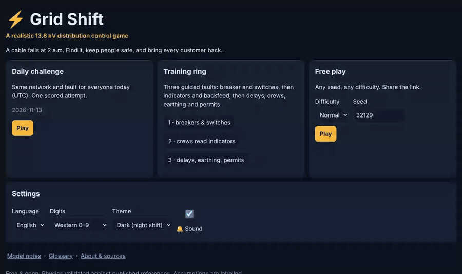

<sub>▶️ Full-quality clip: <a href="docs/media/gameplay.mp4">docs/media/gameplay.mp4</a> · 🇸🇦 <a href="#-بالعربية">النسخة العربية أدناه</a></sub>

</div>

---

## Contents
- [What is this?](#-what-is-this)
- [Screenshots](#-screenshots)
- [How a shift works](#-how-a-shift-works)
- [New: Grading mode](#️-new-grading-mode-protection-coordination)
- [Why it is credible: validated physics](#-why-it-is-credible-validated-physics)
- [Play it](#-play-it)
- [Architecture](#-architecture)
- [How it was made](#-how-it-was-made-research--review-trail)
- [Honest limitations](#-honest-limitations)
- [Roadmap](#-roadmap)
- [بالعربية](#-بالعربية)

---

## 🔌 What is this?

**2 a.m., Riyadh.** A cable fails on a 13.8 kV open-ring network. A breaker at the grid station trips and a few hundred homes go dark. You are the duty control engineer.

You **buy evidence** (relay records, remote and local fault passage indicators, crew reports, damage reports). You **switch**, opening and closing ring switches remotely or through field crews. You **re-energise** through a real pre-switching checklist, and you **isolate, lock, earth and permit** the faulted cable for repair. Then you **restore the normal arrangement**. Your score is **customer-minutes lost**, the metric regulators use, compared with a documented reference strategy.

No existing game we found does this. We surveyed about 20 titles: the free and consumer ones cover transmission balancing, city-building or house wiring ([research/08](research/08-game-design.md)), and only paid professional training simulators cover restoration. Grid Shift is built for both audiences:
- **newcomers** get a guided training ring with plain language;
- **engineers** get an Engineer view, real relay records and a physics engine that reproduces published textbook and vendor results.

| | |
|---|---|
| 🏙️ **Saudi network template** | Open rings between two grid stations, package substations (RMU + Dyn11 transformer), 3×300 mm² Al XLPE, ≤ 50 % ring loading, 60 Hz. Taken from public SEC planning standards and material specifications. |
| ⚙️ **Real engine** | Power flow, IEC 60909-style short circuit (all fault types, neutral earthing resistor, cable capacitance), IEC/IEEE inverse-time relays, fault passage indicators that see only the current through their sensor. |
| 🦺 **Safety taught correctly** | Interlocks act within one panel only; the remote end is protected by procedure (lock & tag, earth, permit). Re-energisation needs a verified checklist. Damage reports block re-energising. |
| 🔁 **Replayable** | Procedural districts, a daily challenge (same seed for everyone, with a rotating *condition of the day*: solid earthing, 40 °C heat, one crew, SCADA trouble, stale indicators, digger strike), free play by seed, shareable replay links. Same seed and same actions give the same result on Chrome, Firefox and Safari engines. |
| 🌍 **Arabic first-class** | Full RTL interface with natural technical Arabic; diagrams are never mirrored; Western or Arabic-Indic digits. |
| 🆓 **Free forever** | Static site, no accounts, no server, no paid APIs, MIT-licensed. |

---

## 📸 Screenshots

| Control room (desktop) | Pre-switching checklist |
|---|---|
| 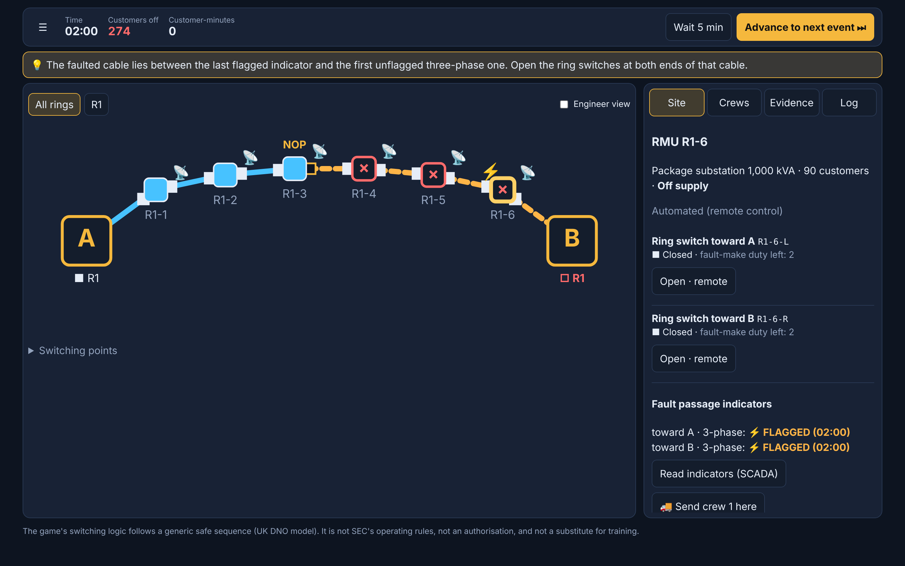 | 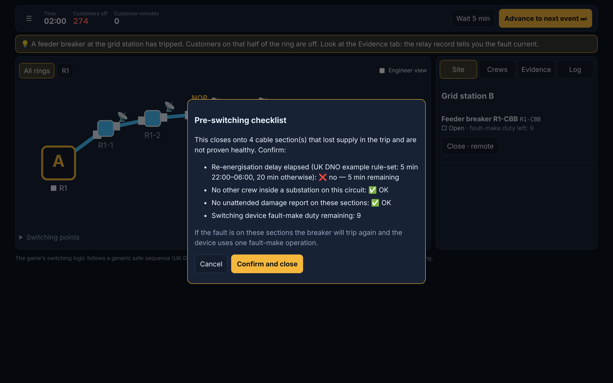 |
| **Shift report: score, what the relay saw, what happened** | **Hard district: three rings, stressed summer loading** |
| 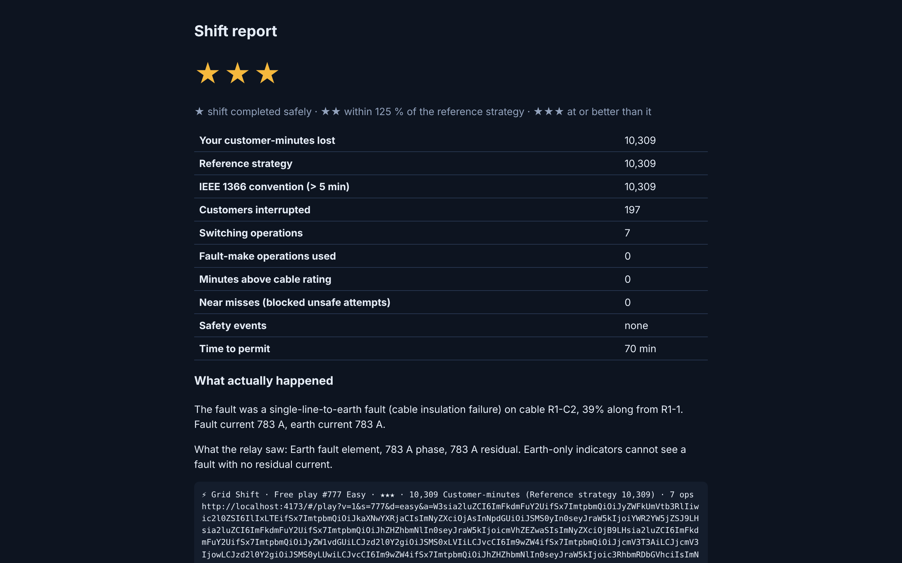 | 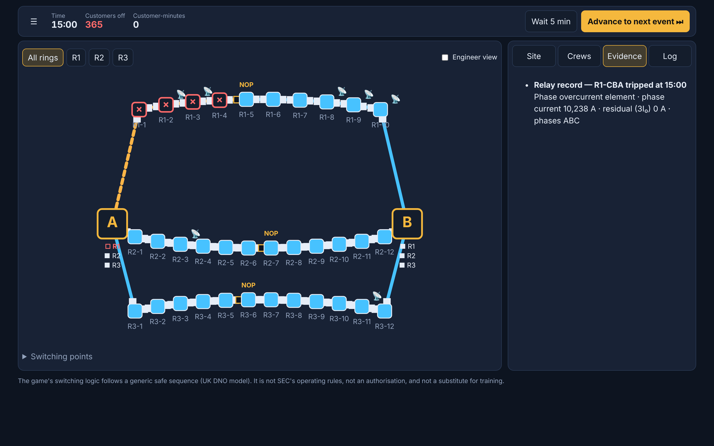 |
| **Arabic interface (RTL)** | **Model notes: every assumption labelled** |
| 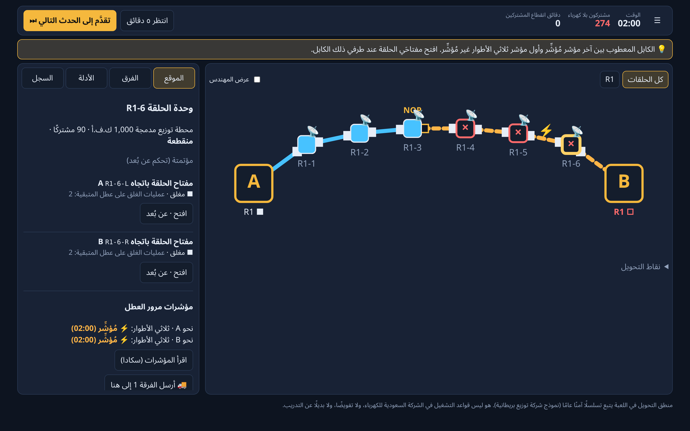 | 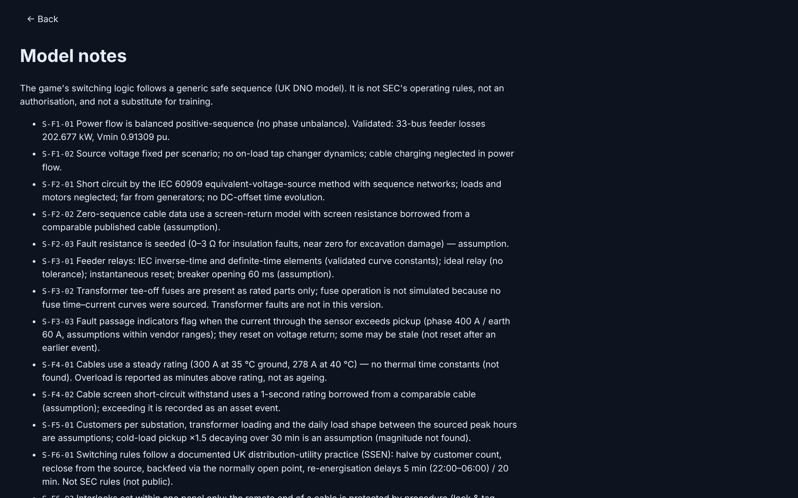 |

<div align="center">

| Phone: ring "ladder" view (Arabic) | Phone: site panel |
|---|---|
| 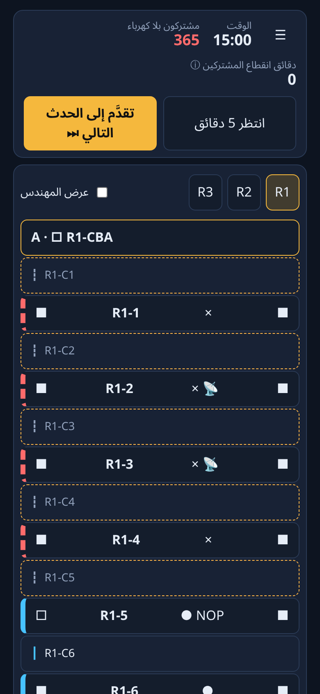 | 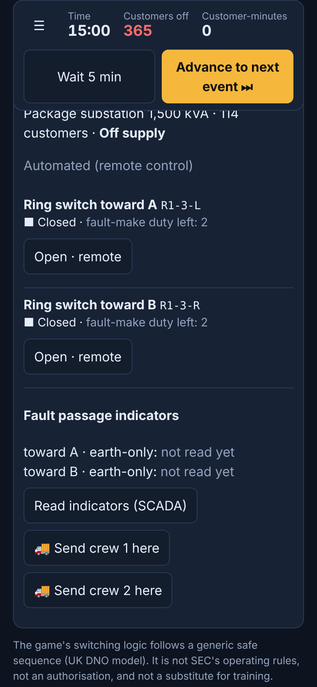 |

</div>

---

## 🧭 How a shift works

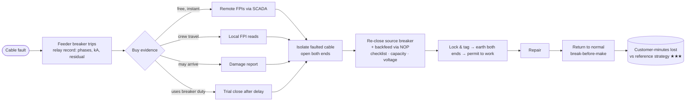

What makes the decisions interesting:
- **Earth-only indicators** can't see a fault with no earth current, such as a digger cutting all three cores. "Not flagged" proves nothing.
- **Backfeed** at a summer peak can overload the healthy feeder and **trip it**. This is emergent from the power flow and the relay curve, not scripted.
- **Waiting** for a crew is slow but certain. **Trial-closing** is fast but uses switchgear duty and is gated by safety rules.
- **Stale indicators** that weren't reset after an earlier event can mislead you on Hard.
- **Safety is procedural, not magic:** lock & tag → test for absence of voltage → earth → permit. A manual field switch can't be used to trial-close an unproven section; only the source breaker or a remote switch can, through the checklist.

---

## ⚖️ New: Grading mode (protection coordination)

Set three overcurrent relays in a chain, **RMU tee-off breaker → feeder breaker → grid-station incomer**, so that:
- the nearest relay trips first, with at least a **0.3 s** grading margin (IEEE 242 range 0.25–0.4 s);
- no relay trips on load, and the tee-off does not trip on **transformer inrush** (12 × In for 100 ms);
- every fault is cleared quickly.

The engine applies faults at the transformer LV terminals, on the cable and at the busbar, at maximum and minimum levels. It plots everything on a log-log time–current chart and compares your total clearing time with a reference grading.

| Grading on desktop (reference shown in grey) | Arabic on a phone |
|---|---|
| 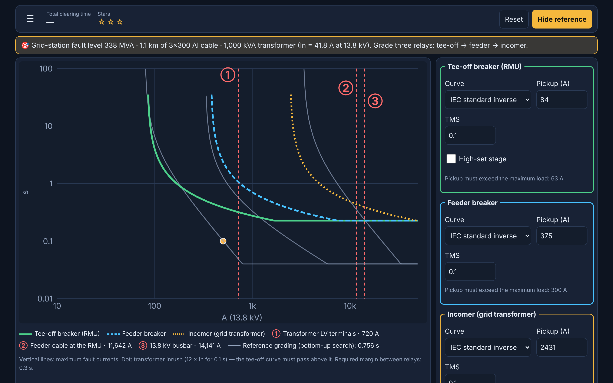 | 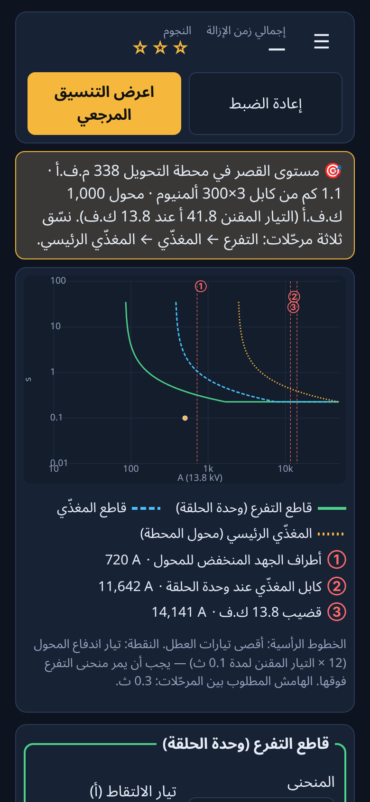 |

---

## ✅ Why it is credible: validated physics

Every engine model is checked against **published worked examples**. Excerpt from [`docs/VALIDATION.md`](docs/VALIDATION.md):

| Model | Reference | Published | Engine |
|---|---|---|---|
| Power flow | Baran & Wu 33-bus feeder (MATPOWER data) | 202.677 kW losses, Vmin 0.91309 pu @ bus 18 | **202.677 kW, 0.91309 pu @ bus 18** |
| Short circuit, 4 fault types | Glover/Sarma/Overbye, Examples 9.2–9.5 | 3φ 7.558 · SLG 5.8928 · LL 6.391 · DLG 6.8983 pu | **7.5578 · 5.8928 · 6.3913 · 6.8983 pu** |
| Earth fault with NER + cable capacitance | Schneider Cahier Technique 18 §4.3 | 31.75 + j2.99 A | **31.895 A (magnitude)** |
| NER-limited earth fault | Dyn 33/11 kV worked example | 10,497 A solid → 399 A with 15.9 Ω | **10,497 A → 399.1 A** |
| Relay curves | IEC 60255-151 / IEEE C37.112 (35 points) | e.g. SI 10.029 s @ 2× | **10.029 s** (±0.1 %) |
| Reliability metric | Ofgem worked example | 34 min | **34 min** |
| Transformer thermal (for Heatwave mode) | IEC 60076-7 Annex C, 41 steps | 90.5 … 176.1 °C; 6.15 days loss of life | **worst error 0.05 K; 8,851 min** |
| Determinism | same seed + actions on V8, SpiderMonkey, JavaScriptCore | identical | **identical (CI, 3 engines)** |

Every Saudi parameter carries a source ID ([`research/SOURCES.md`](research/SOURCES.md), ~420 entries) or is **labelled as an assumption** in the in-game Model notes. No proprietary or employer data is used.

---

## 🎮 Play it

**Online:** the deploy pipeline is ready and enabling GitHub Pages is a one-time click ([`docs/NEEDS-AHMAD.md`](docs/NEEDS-AHMAD.md)). Once enabled, the game is at **https://ahmad-nayfeh.github.io/Repo-A/**.

**Locally** (Node 22):

```bash
git clone https://github.com/Ahmad-Nayfeh/Repo-A.git && cd Repo-A
```
```bash
npm ci && npx vite build && npx vite preview
```

Then open http://localhost:4173. Modes:
- **Night Shift:** Training ring (3 guided faults), Daily challenge, Free play (Easy · Normal · Hard).
- **Grading:** protection coordination.

**Run the checks:**
```bash
npx vitest run
```
```bash
npx playwright test --trace off
```

---

## 🏗️ Architecture

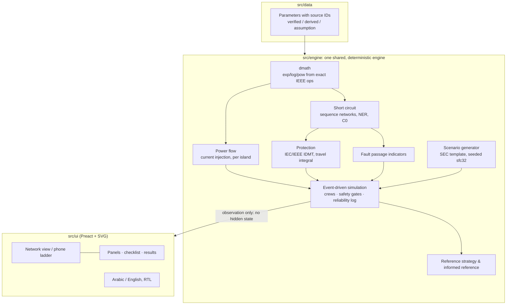

- **TypeScript + Vite + Preact**, static build, 53 KB gzipped JS.
- **Determinism:** state code uses only operations ECMAScript specifies exactly. `Math.exp/log/pow` are banned by lint and replaced by `dmath`, so a seed and an action list replay identically on every browser.
- **Modes are thin layers** over the engine. Next on the roadmap are Grading (protection coordination), Heatwave (transformer thermal) and Planning.

```
src/engine   power flow · short circuit · protection · FPIs · simulation · generator · bot
src/data     sourced parameters (SEC specs, IEC/IEEE, vendor ranges) with labels
src/ui       game screens, network view, phone ladder, model notes, glossary
src/i18n     English / Arabic strings, digits, RTL
tests/       golden (published references) · unit · property gates · e2e (Playwright)
research/    12 topic notes, synthesis, bibliography, independent review
docs/        design (GDD, architecture, fidelity), org charters & gates, decisions, validation
```

---

## 🔬 How it was made (research & review trail)

The project was run like a small engineering organisation, with **independent reviews at every gate**:

1. **Research:** 12 topic notes and about 420 sources ([`research/`](research/)) covering Saudi grid codes and SEC specifications, short-circuit theory, protection, power flow, thermal limits, power quality, operations and safety, and game design. Synthesis: [`research/SYNTHESIS.md`](research/SYNTHESIS.md).
2. **Independent research review:** 31 findings, all resolved ([`research/REVIEW-phase1.md`](research/REVIEW-phase1.md)).
3. **Organisation:** 10 departments, each with a measurable gate ([`docs/org/`](docs/org/)).
4. **Design:** [`GDD`](docs/design/GDD.md), [`Architecture`](docs/design/ARCHITECTURE.md), [`Fidelity contract`](docs/design/FIDELITY.md). Independent design review: 30 findings, all resolved ([`REVIEW-phase3`](docs/design/REVIEW-phase3.md)).
5. **Build:** engine first, validated with golden tests ([`docs/VALIDATION.md`](docs/VALIDATION.md)), then the flagship mode.
6. **Every decision logged:** [`docs/DECISIONS.md`](docs/DECISIONS.md).

---

## 🧪 Independent reviews

Every phase was gated by a fresh-context reviewer, and every finding is tracked to a fix:

| Gate | Findings | Report |
|---|---|---|
| Research | 31 (1 critical) → all fixed | [`research/REVIEW-phase1.md`](research/REVIEW-phase1.md) |
| Design | 30 (2 critical) → all fixed | [`docs/design/REVIEW-phase3.md`](docs/design/REVIEW-phase3.md) |
| Release: physics & safety | 18 → important ones fixed | [`docs/qc/REVIEW-release1-physics-safety.md`](docs/qc/REVIEW-release1-physics-safety.md) |
| Release: playtest, UX & Arabic | 23 (2 critical) → fixed, regression-tested | [`docs/qc/REVIEW-release1-playtest.md`](docs/qc/REVIEW-release1-playtest.md) |

## ⚠️ Honest limitations

- Operational rules follow a **documented UK distribution utility's practice** (SSEN), because SEC's operating manuals are not public. The game says so in-game: *not SEC rules, not an authorisation, not a substitute for training.*
- **Assumptions** (clearly labelled): crew travel times, customers per substation, cold-load pickup, the NER current used in Riyadh, FPI thresholds, switchgear duty counts.
- Not modelled in v1: phase unbalance and LV networks, transients and ferroresonance, transformer thermal ageing (planned for Heatwave mode), fuse operation.

---

## 🗺️ Roadmap

1. Persistent "home district" and a condition-of-the-day rotation for the daily.
2. ✅ ~~Grading mode~~ shipped; next: earth-fault grading levels and fuse curves.
3. **Heatwave** mode: the thermal engine is done and validated; it still needs LV load transfer and demand response.
4. **Planning** mode: SEC planning rules and loss capitalisation.
5. Case files: voltage-sag detective, capacitor resonance, broken neutral, GB 9 Aug 2019 frequency event.

Full list: [`docs/ROADMAP.md`](docs/ROADMAP.md) · Current state: [`docs/STATUS.md`](docs/STATUS.md)

---

## 🇸🇦 بالعربية

<div dir="rtl">

### ما هي «مناوبة الشبكة»؟

**الساعة الثانية فجرًا في الرياض.** تعطّل كابل في شبكة حلقية مفتوحة على جهد ١٣٫٨ ك.ف، فصل قاطع المغذّي في محطة التحويل، وانقطعت الكهرباء عن مئات المنازل. أنت مهندس التحكم المناوب.

- **تجمع الأدلة:** سجل المرحّل، ومؤشرات مرور العطل عن بُعد أو عبر الفرق الميدانية، وبلاغات الضرر.
- **تُحوِّل:** تفتح مفاتيح الحلقة وتغلقها عن بُعد أو بواسطة الفرق.
- **تُعيد التغذية:** عبر قائمة تحقق حقيقية قبل التحويل.
- **تُؤمِّن الجزء المعطوب:** تعزله، وتقفله وتعلّق البطاقة، وتؤرّضه، وتُصدر تصريح العمل للإصلاح.
- **تُعيد الترتيب الطبيعي** للشبكة بعد الإصلاح.

تُقاس نتيجتك بـ**دقائق انقطاع المشتركين**، وهو المؤشر الذي تعتمده الجهات التنظيمية، مقارنةً باستراتيجية مرجعية موثقة.

### لماذا هي موثوقة؟

- **محرك فيزيائي مُتحقَّق منه** مقابل أمثلة منشورة: سريان القدرة (مغذّي ٣٣ عقدة: ٢٠٢٫٦٧٧ ك.و)، وتيارات القصر بأنواعها الأربعة، وتأريض نقطة التعادل بمقاومة، ومنحنيات المرحّلات وفق IEC وIEEE، ومؤشرات الموثوقية.
- **قالب الشبكة مأخوذ من وثائق عامة** للشركة السعودية للكهرباء: حلقات مفتوحة بين محطتَي تحويل، ومحطات توزيع مدمجة، وكابل ٣×٣٠٠ مم² ألمنيوم، وتحميل الحلقة ≤ ٥٠٪.
- **كل قيمة لها مصدر** أو موسومة بوضوح كافتراض في صفحة «ملاحظات النموذج». لا تُستخدم أي بيانات خاصة.

### السلامة أولًا

اللعبة تُعلّم الممارسة الآمنة فقط:
- التعشيق يحمي داخل اللوحة الواحدة، أما الطرف البعيد من الكابل فتحميه الإجراءات: القفل والبطاقة، والتأريض، وتصريح العمل.
- إعادة التغذية تتطلب قائمة تحقق: انقضاء المهلة، وابتعاد الفرق، وعدم وجود بلاغ ضرر لم يُتفقَّد.
- **تنبيه:** منطق التحويل يتبع نموذجًا آمنًا عامًا (شركة توزيع بريطانية). هو ليس قواعد التشغيل في الشركة السعودية للكهرباء، ولا تفويضًا، ولا بديلًا عن التدريب.

### كيف تلعب؟

- **عبر الإنترنت:** بعد تفعيل GitHub Pages ستكون اللعبة على الرابط https://ahmad-nayfeh.github.io/Repo-A/
- **محليًا:** نفّذ الأوامر في قسم «Play it» أعلاه.

الأوضاع المتاحة: **حلقة التدريب** (ثلاثة أعطال موجَّهة)، و**تحدّي اليوم** (البذرة نفسها للجميع)، و**اللعب الحر** بثلاثة مستويات صعوبة.

### ما القادم؟

- ✅ وضع **«التنسيق»** متاح الآن: اضبط مرحّلات التفرع والمغذّي والمغذّي الرئيسي على منحنى زمن–تيار لوغاريتمي.
- وضع **«موجة الحر»** لتحميل المحولات حراريًا بمعاملات مواصفات الشركة السعودية للكهرباء.
- وضع **«التخطيط»** للتوسعة.
- **ملفات حالات** لجودة القدرة.

</div>

---

<div align="center">
<sub>MIT licensed · Fonts: Noto Sans Arabic (SIL OFL 1.1) · Built with TypeScript, Preact and Vite · Physics references and every decision are documented in this repository.</sub>
</div>
